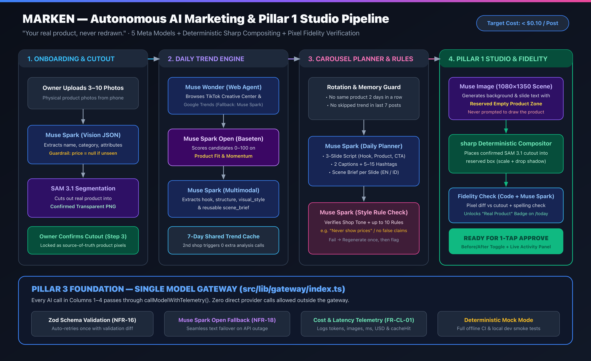
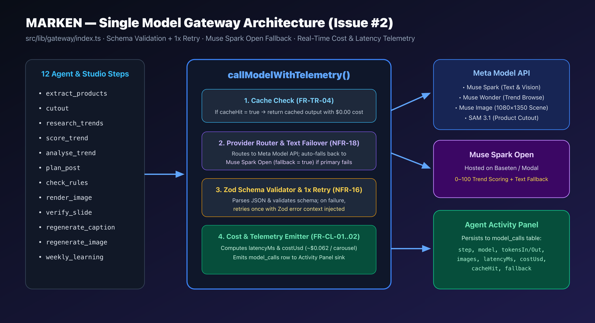
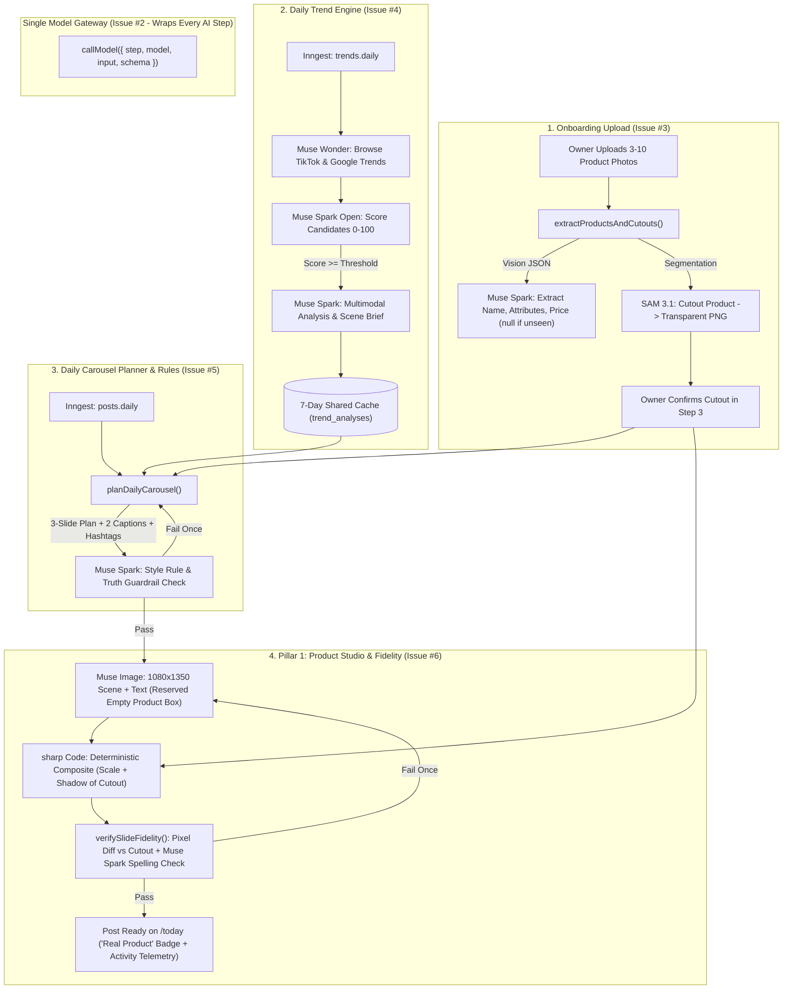
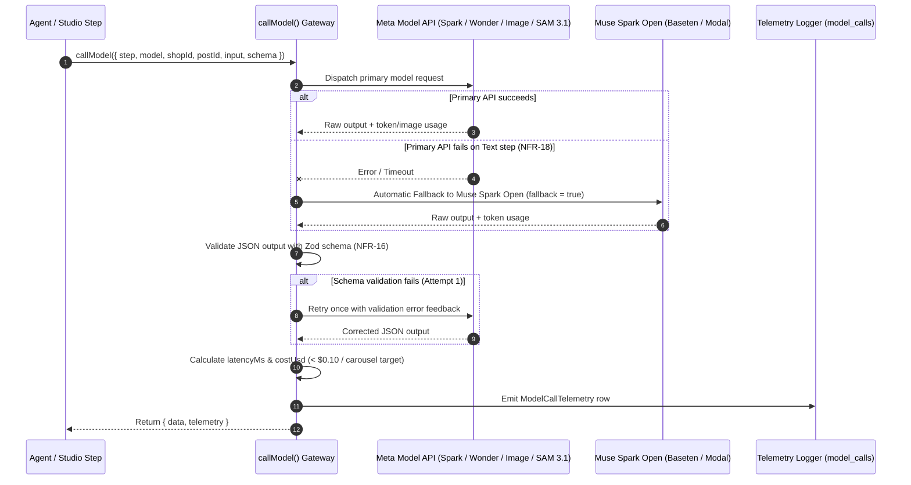

# MARKEN — AI Engine, Single Model Gateway & Pillar 1 Studio Architecture

**Workstream Owner:** Altaf (`workstream:ai-altaf`)  
**Hackathon:** Meta Global AI Developer Hackathon  
**Headline Promise:** *"Your real product, never redrawn."*

---

## High-Resolution Exportable Diagrams (LinkedIn / Deck Ready)

Ready-to-share PNG and SVG visuals are stored in `docs/images/`:
- **End-to-End AI Pipeline:** [`docs/images/ai-pipeline-flow.png`](./images/ai-pipeline-flow.png) · [`docs/images/ai-pipeline-flow.svg`](./images/ai-pipeline-flow.svg)
- **Single Model Gateway (`FR-CL-01`):** [`docs/images/ai-gateway-flow.png`](./images/ai-gateway-flow.png) · [`docs/images/ai-gateway-flow.svg`](./images/ai-gateway-flow.svg)

---

## 1. Why MARKEN Uses a Hybrid AI + Deterministic Pixel Pipeline

Standard text-to-image models redraw physical products, warping logos, packaging labels, and textures. MARKEN's AI architecture separates **creative world-building** (handled by Meta generative models) from **product pixel preservation** (handled by `SAM 3.1` + deterministic `sharp` compositing):

| Stage | Module | Meta Model / Engine | Role in Pipeline |
| :--- | :--- | :--- | :--- |
| **0. Model Gateway** | `src/lib/gateway/` | `Muse Spark`, `Muse Wonder`, `Muse Spark Open`, `Muse Image`, `SAM 3.1` | Single entry point (`callModel`). Enforces Zod JSON validation (1x retry), falls back to `Muse Spark Open` on text errors, and logs latency & USD cost (`< $0.10` per carousel). |
| **1. Onboarding Cutout & Catalog** | `src/lib/studio/cutout.ts` `src/lib/agents/extract.ts` | `SAM 3.1` + `Muse Spark` | Segments each uploaded product photo into a confirmed transparent PNG cutout (`SAM 3.1`) and extracts structured catalog metadata (`price = null` when not visible). |
| **2. Daily Trend Engine** | `src/lib/agents/trends.ts` | `Muse Wonder` + `Muse Spark Open` + `Muse Spark` | Browses TikTok Creative Center & Google Trends (`Muse Wonder`), scores candidates 0–100 (`Muse Spark Open`), and caches multimodal scene briefs for 7 days (`Muse Spark`). |
| **3. Carousel Planner & Guardrails** | `src/lib/agents/planner.ts` `src/lib/agents/rules.ts` | `Muse Spark` | Plans a 3-slide carousel (`hook`, `product`, `cta`), 2 captions, and 5–15 hashtags in the shop's language, then verifies compliance against up to 10 shop style rules. |
| **4. Pillar 1 Studio & Fidelity** | `src/lib/studio/composite.ts` `src/lib/studio/fidelity.ts` | `Muse Image` + `sharp` + `Muse Spark` | Generates a 1080×1350 (4:5) scene with a **reserved empty product zone** (`Muse Image`), deterministically composites the real `SAM 3.1` cutout (`sharp`), and verifies pixel fidelity + slide spelling (`Code + Muse Spark`). |

---

## 2. Mermaid Diagrams (Interactive GitHub View)

### 2A. End-to-End AI Pipeline Flow

### 2B. Single Model Gateway Sequence (`src/lib/gateway/index.ts`)

