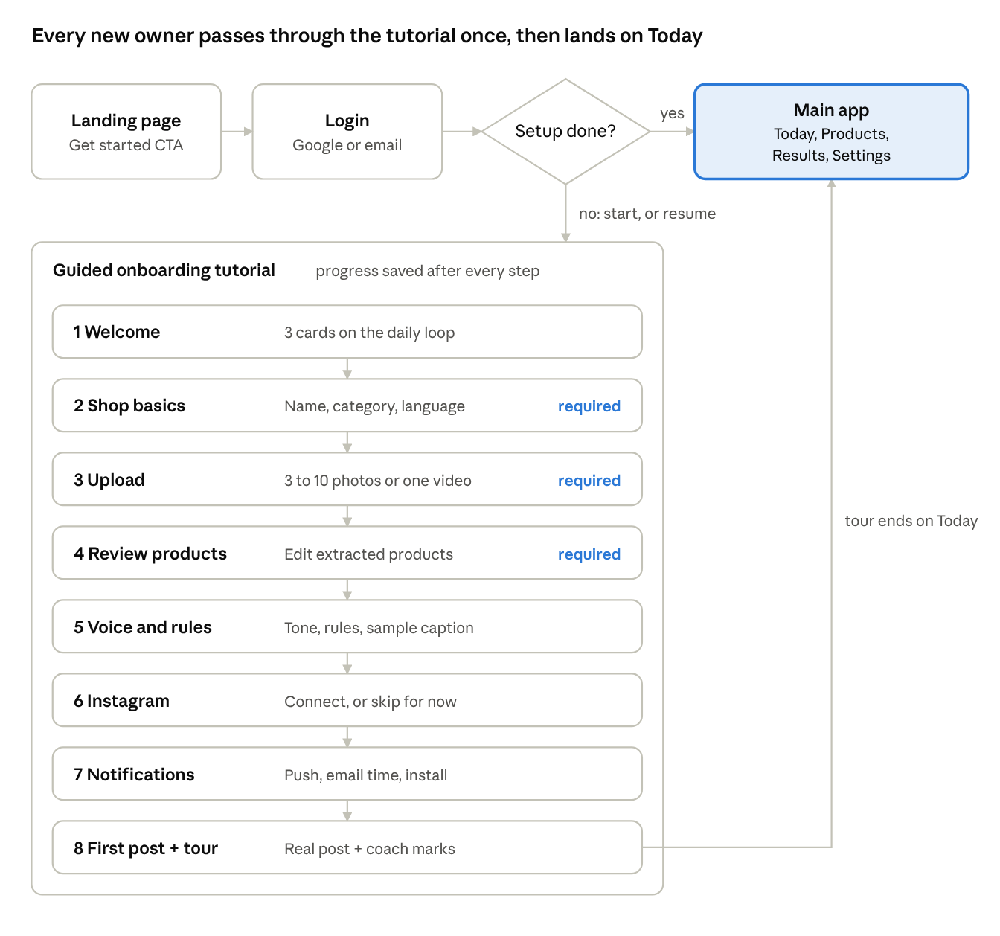
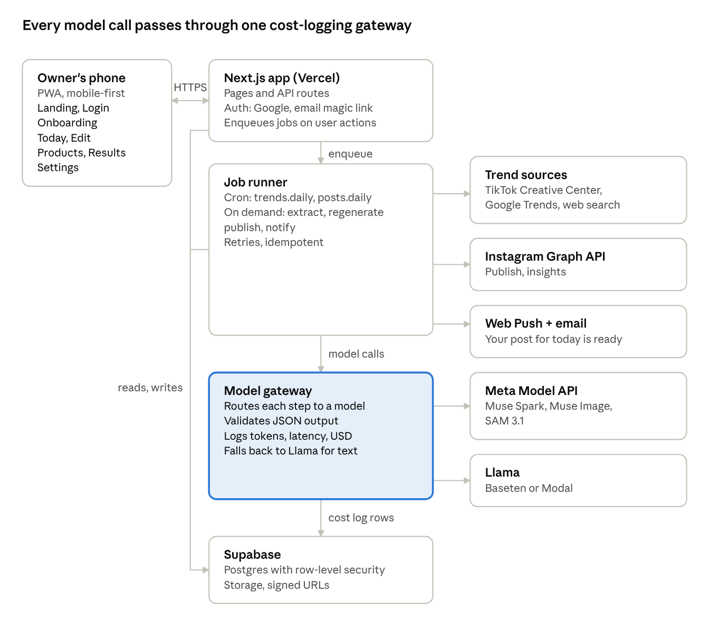
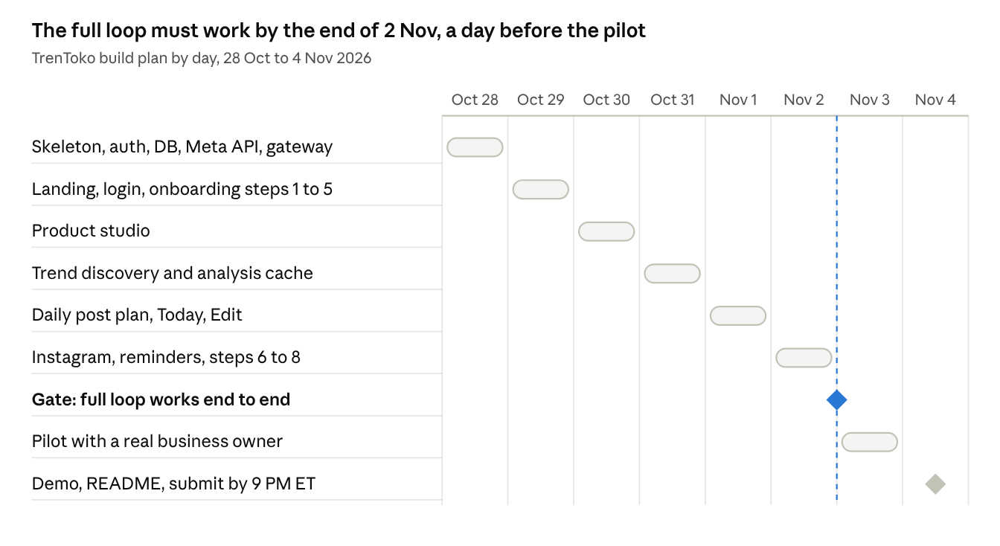

# MARKEN — Software Requirements Document (SRD)

v1.0 · 28 Oct 2026 · Live doc: https://claude.ai/artifact/DKRJqBPBBAky1nwdjrGUqz

## Document control

SRD v1.0 turns PRD v1.0 (20 Oct 2026) into buildable requirements for the Meta Global AI Developer Hackathon, with four changes from the PRD.

| Change | PRD v1.0 | SRD v1.0 | Why |
| --- | --- | --- | --- |
| Target user | Indonesian small sellers | Business owners: small, owner-run businesses in any country | The hackathon is international |
| Content language | Bahasa Indonesia only | Owner picks a content language per shop; English and Bahasa Indonesia at demo | Follows from the international audience |
| P2 features | Mentor dashboard, TikTok and Shopee publishing, Influencer matching | Removed. US-09 and the mentor persona are removed with them | Scope cut for the 10-day build |
| Onboarding | One setup screen | Full flow: Landing page → Login → Guided onboarding tutorial → Main app | New requirement |

Requirement IDs: `F-xx` = feature, `FR-<area>-xx` = functional requirement, `NFR-xx` = non-functional requirement. P0 must be in the demo; P1 is built if time allows.

## 1. Introduction

### 1.1 Purpose

This SRD tells the build team exactly what MARKEN must do by the 4 Nov 2026 submission. Each requirement has an ID, a priority and a testable acceptance criterion.

### 1.2 Product in one line

MARKEN is an AI marketing team for small business owners. It finds what is trending, turns it into a ready-to-post piece of content for the owner's products, and publishes it to Instagram after one tap of approval.

### 1.3 Scope

In scope: a mobile-first, installable web app (PWA) with a public landing page, login, a guided onboarding tutorial, and the main app (Today, Edit, Products, Results, Settings). Behind it runs a daily agent loop that learns the shop, finds trends, plans content, makes visuals, waits for approval, publishes, and learns from results.

Out of scope for the hackathon:

- WhatsApp, Telegram or any chat-app interface
- Payments and subscriptions
- Paid ads management
- Publishing to TikTok, Shopee or Facebook
- Mentor dashboard (multi-shop view for program mentors)
- Influencer and affiliate matching
- Training our own ranking model

### 1.4 Definitions

| Term | Meaning |
| --- | --- |
| Business owner | The person who runs a small business and uses MARKEN. Called "owner" below |
| Shop | One business profile: products, tone, style rules, content language, connected Instagram account. One owner can have several |
| Post | One piece of suggested content: image, two caption options, hashtags, and the reason the trend fits |
| Trend | A trending format, hashtag or sound collected from a public source |
| Style rules | Free-text rules the owner sets once (e.g. "never show prices") that every output must follow |
| Agent loop | The daily server-side pipeline that produces a post per shop |
| Guided tour | Coach marks that walk the owner through the main app on their first post |

### 1.5 References

- MARKEN PRD v1.0, 20 Oct 2026 (original PDF, written under the old name TrenToko; superseded by this SRD and no longer in the repo)
- Meta Model API: Muse Spark, Muse Image, SAM 3.1; Llama open weights
- Instagram Graph API, content publishing and insights

## 2. Overall description

### 2.1 Product perspective

MARKEN is an agent, not a chat window. It runs a seven-step loop every day for each shop, and the owner joins only at the approval step.

| Step | What happens | Model |
| --- | --- | --- |
| 1. Learn the shop | Owner uploads product photos or a short video and answers a few questions. The agent builds a shop profile: products, prices, tone, style rules | Muse Spark |
| 2. Find trends | Collect trending formats, hashtags and sounds from public sources; score them cheaply; analyse the best ones once and cache the analysis for every shop | Muse Spark + Llama |
| 3. Plan content | Match trends to products. Write script, shots, caption and hashtags in the shop's content language, following its style rules | Muse Spark |
| 4. Make visuals | Cut the product out of the owner's photo and place it on a trend-matched background with promo text | SAM 3.1 + Muse Image |
| 5. Owner approves | Post appears on the Today screen. Owner taps Approve, Edit or Skip | None |
| 6. Publish | Post goes live on the owner's Instagram | None |
| 7. Learn | Record views, likes, shares and orders; summarise weekly; adjust future plans | Muse Spark |

### 2.2 User personas

| Persona | Context | What they need from MARKEN |
| --- | --- | --- |
| Food or snack business owner (primary) | Home business; sells on Instagram and a marketplace; runs everything from a phone | A good post every day without learning new tools |
| Fashion or craft business owner (secondary) | Visual products; sells through Instagram and social commerce | Clean product photos and short trend videos |

Design implication: most owners use MARKEN in a phone browser. The app must be mobile-first, fast on a mid-range Android phone, and installable to the home screen.

### 2.3 User stories

| ID | As a... | I want to... | So that... |
| --- | --- | --- | --- |
| US-01 | owner | set up my shop by uploading photos instead of filling long forms | I can start in minutes |
| US-02 | owner | get one ready post every morning without asking | I never have to think about what to post |
| US-03 | owner | see why a trend fits my product | I trust the suggestion |
| US-04 | owner | approve a post with one tap | posting takes seconds, not an hour |
| US-05 | owner | tell the agent what to change in my own words | I don't need design skills |
| US-06 | owner | get clean studio photos of my products | my shop looks professional |
| US-07 | owner | set rules once (tone, slang, no prices) | every post sounds like me |
| US-08 | owner | see which posts brought orders | I know what to do more of |
| US-10 | new visitor | understand what MARKEN does before signing up | I know it is worth my time |
| US-11 | new owner | be walked through setup and the app step by step | I get my first post without getting lost |

US-09 (mentor view) is removed with the mentor dashboard. US-10 and US-11 are new for the onboarding flow.

### 2.4 Assumptions and constraints

- Build window: 26 Oct to 4 Nov 2026; submission by 9:00 PM ET on 4 Nov. As of 28 Oct the repo holds only a README, so the build starts from zero.
- Models: Meta Model API (Muse Spark, Muse Image, SAM 3.1) for all AI steps; Llama on Baseten or Modal partner credits for cheap high-volume tasks and as a text fallback.
- Publishing needs an Instagram Business or Creator account. Graph API app review may be slow, so the demo uses an account the team owns.
- No official trend API exists for TikTok or Instagram. Trends come from TikTok Creative Center, Google Trends and Muse Spark web search.
- Target device: mid-range Android phone on 4G; the app must also work on desktop.
- Nothing is ever published without the owner's explicit Approve.

## 3. Feature scope

The demo ships 15 P0 features, two of them new (Landing page, Guided onboarding). Four P1 features follow if time allows; every P2 feature is cut.

| ID | Feature | Description | Model | Priority |
| --- | --- | --- | --- | --- |
| F-01 | Landing page (new) | Public page that explains MARKEN and leads to sign-up | None | P0 |
| F-02 | Account and auth | Google or email sign-in; one owner can own several shops | None | P0 |
| F-03 | Guided onboarding tutorial (new) | Step-by-step shop setup, then a guided tour of the main app on the first real post | Muse Spark | P0 |
| F-04 | Product extraction | Products, prices and attributes extracted from uploaded photos or video | Muse Spark | P0 |
| F-05 | Style rules | Tone and rules saved per shop and applied to every output | Muse Spark | P0 |
| F-06 | Trend discovery | Daily trend collection from public sources and web search | Muse Spark | P0 |
| F-07 | Trend analysis cache | Hook, structure and length of top trend videos, shared across shops | Muse Spark | P0 |
| F-08 | Daily post plan | Script, caption and hashtags matched to a product and a trend | Muse Spark | P0 |
| F-09 | Product studio | Background removal and on-brand product photos | SAM 3.1 + Muse Image | P0 |
| F-10 | Today screen and approval | Preview, Approve, Edit, Skip; nothing publishes without Approve | None | P0 |
| F-11 | Edit by feedback | Regenerate caption or image from free-text feedback | Muse Spark, Muse Image | P0 |
| F-12 | Instagram publishing | Publish approved posts through the Instagram Graph API | None | P0 |
| F-13 | Push and email reminders | Morning notification that today's post is ready | None | P0 |
| F-14 | Cost log | Every model call logged with step, model, tokens and cost | None | P0 |
| F-15 | Settings | Edit shop profile, style rules, notification time, Instagram connection; replay the tour | None | P0 |
| F-16 | Trend scoring | Cheap filter before any video analysis | Llama | P1 |
| F-17 | Results tracking | Views, likes, shares, owner-entered orders | None | P1 |
| F-18 | Weekly learning | Summary of what worked, saved to shop memory | Muse Spark | P1 |
| F-19 | UGC-style video scripts | Customer-review style scripts in the shop's language, casual tone | Muse Spark | P1 |
| F-20 | Video auto-cut | Cut the owner's rough clips into a vertical short following the script | SAM 3.1 + Muse Spark | P1 |

Cut from the PRD (P2): Mentor dashboard, TikTok and Shopee publishing, Influencer matching.

F-15 Settings is not a separate PRD feature. It is listed because the onboarding tour must be replayable and style rules must be editable after setup.

## 4. User flow

A new owner goes Landing → Login → guided onboarding → main app. A returning owner skips straight to Today; an unfinished setup resumes at its saved step.

Step 8 generates the owner's first real post and runs the guided tour on it, so the tutorial ends exactly where the daily habit starts. Requirements for each step are in 5.3.

## 5. Functional requirements

Every requirement below is P0 unless marked P1. "Shall" means the demo fails review without it.

### 5.1 Landing page (F-01)

| ID | Requirement | Acceptance criteria |
| --- | --- | --- |
| FR-LP-01 | The system shall serve a public landing page at `/` with: headline value proposition, a three-step "how it works" (Learn your shop → Find trends → Approve and post), a sample post preview, and a primary "Get started" button | Logged-out visitor sees all four elements on a 360 px wide screen without horizontal scroll |
| FR-LP-02 | "Get started" and "Log in" shall open `/login` | One tap from landing to login |
| FR-LP-03 | A logged-in owner who opens `/` shall be redirected: onboarding incomplete → their saved onboarding step; complete → `/today` | Redirect happens server-side, no landing flash |
| FR-LP-04 | The landing page shall be static and cacheable | LCP under 2.5 s on a mid-range Android phone over 4G |

### 5.2 Account and auth (F-02)

| ID | Requirement | Acceptance criteria |
| --- | --- | --- |
| FR-AU-01 | Owners shall sign in with Google OAuth or an email magic link | Both paths create the same user record; no password is stored |
| FR-AU-02 | First sign-in shall create the user and route to `/onboarding` | New user lands on onboarding step 1 |
| FR-AU-03 | Sessions shall persist for 30 days on the device and support log-out | Reopening the installed PWA within 30 days skips login |
| FR-AU-04 | All app routes shall require auth; data access shall be scoped to shops the owner owns | Requesting another owner's shop returns 403 / no rows |
| FR-AU-05 | One owner shall be able to own several shops and switch between them | Shop switcher in Settings; "Add shop" re-runs onboarding steps 2–5 for the new shop |

### 5.3 Guided onboarding tutorial (F-03)

The flow is eight steps (section 4). Steps 2–4 are required; the rest can be skipped.

| ID | Requirement | Acceptance criteria |
| --- | --- | --- |
| FR-OB-01 | Step 1 Welcome: three swipeable cards explaining the daily loop and that nothing posts without approval | "Skip intro" jumps to step 2 |
| FR-OB-02 | Step 2 Shop basics: shop name, business category, country, content language, time zone (auto-detected, editable) | Cannot continue until name, category and language are set |
| FR-OB-03 | Step 3 Upload: 3–10 photos (JPG, PNG, HEIC, up to 10 MB each) or one video (up to 60 s, 100 MB). Show per-file progress | Invalid type or size is rejected with a message before upload |
| FR-OB-04 | Step 4 Review products: show the products Muse Spark extracted (F-04); owner can edit, delete or add products | At least one product must remain to continue |
| FR-OB-05 | Step 5 Voice and rules: pick tone (casual, friendly, formal) and write rules; show a live sample caption that uses them | Sample caption refreshes within 10 s of a change |
| FR-OB-06 | Step 6 Connect Instagram: OAuth to an Instagram Business or Creator account; "Skip for now" allowed | Skipped owners can still approve; Approve then offers download image + copy caption |
| FR-OB-07 | Step 7 Notifications: ask for web push permission, set daily time (default 08:00 local), prompt to install the PWA | Denying push falls back to email only |
| FR-OB-08 | Step 8 First post + guided tour: generate the first real post, then coach marks on the Today screen (preview, why this trend, caption choice, Approve, Edit, Skip) and on the bottom nav (Products, Results, Settings) | Tour can be skipped at any mark; ends on Today with the post ready |
| FR-OB-09 | While the first post generates, the tour shall run on a sample post and swap to the real one when ready | Owner never waits on a blank screen |
| FR-OB-10 | A progress indicator ("Step 3 of 8") and Back shall be on every step | Back keeps entered data |
| FR-OB-11 | Progress shall be saved server-side after each step | Closing the app at step 5 and reopening resumes at step 5 |
| FR-OB-12 | Each step's start and finish time shall be logged | Time from sign-up to first post is measurable per owner |
| FR-OB-13 | The tour shall be replayable from Settings | "Replay tour" restarts coach marks without changing data |

Acceptance for the whole flow: median time from sign-up to first suggested post under 5 minutes (PRD goal).

### 5.4 Shop profile: product extraction and style rules (F-04, F-05)

| ID | Requirement | Acceptance criteria |
| --- | --- | --- |
| FR-SP-01 | Muse Spark shall extract products from uploads as structured JSON: name, category, price, currency, attributes, short description, source media IDs | 10 photos processed in under 30 s; output validates against the schema |
| FR-SP-02 | Price shall be null when not visible; the owner is asked to fill it | No invented prices |
| FR-SP-03 | Owners shall add, edit and hide products in the Products screen | Hidden products are never picked for a post |
| FR-SP-04 | Style rules: one tone value plus up to 10 free-text rules of up to 200 characters, stored per shop | Rules editable in Settings |
| FR-SP-05 | Tone, rules and content language shall be injected into every generation prompt | Any caption, script or image text follows them |
| FR-SP-06 | Every generated caption shall pass a rule check before it is shown; a failed check regenerates once, then flags the post | A "never show prices" shop never sees a price in a caption |

### 5.5 Trend engine (F-06, F-07, F-16)

| ID | Requirement | Acceptance criteria |
| --- | --- | --- |
| FR-TR-01 | A daily job shall collect trend candidates (format, hashtag, sound) from TikTok Creative Center, Google Trends and Muse Spark web search, per country that has an active shop | Each run stores source, type, country, title, URL, collected-at |
| FR-TR-02 | The top candidates per country (10 by default) shall go to analysis; without F-16 they are ranked by source rank | Analysis count per run is capped |
| FR-TR-03 | Muse Spark shall analyse each selected trend once: hook, structure, length, why it works | Analysis stored as structured JSON |
| FR-TR-04 | Trend analyses shall be cached for 7 days and reused by every shop | A second shop using the same trend triggers zero new analysis calls (checked in the cost log) |
| FR-TR-05 | P1 (F-16): Llama shall score each candidate 0–100 for fit and momentum before analysis | Only candidates above the threshold reach Muse Spark |

### 5.6 Content generation (F-08, F-09)

| ID | Requirement | Acceptance criteria |
| --- | --- | --- |
| FR-CG-01 | A daily plan job shall pick one visible product and one cached trend per shop and produce JSON: product ID, trend ID, fit reason, script and shots, two caption options, 5–15 hashtags, image brief | Output validates against the schema; text is in the shop's content language |
| FR-CG-02 | The plan shall avoid the same product two days in a row and any trend the owner skipped | Checked against the last 7 posts |
| FR-CG-03 | Product studio: SAM 3.1 shall cut the product out of the owner's photo using a text prompt built from the product name | Cutout PNG with transparent background |
| FR-CG-04 | Muse Image shall place the cutout on a trend-matched background with readable promo text, at 1080×1350 (4:5) | Promo text is spelled correctly and follows style rules |
| FR-CG-05 | Each product shall have a studio photo on the Products screen, regenerable on demand | Owner can regenerate from the product card |
| FR-CG-06 | The post shall be ready before the owner's notification time | Plan + visuals finish in under 3 minutes per shop |

### 5.7 Today screen and approval (F-10)

| ID | Requirement | Acceptance criteria |
| --- | --- | --- |
| FR-TD-01 | Today shall show: post image, two caption options to choose from, hashtags, "Why this trend fits", a link to the trend, and Approve, Edit, Skip | All visible on a 360 px screen with one scroll at most |
| FR-TD-02 | Nothing shall publish without an explicit Approve tap | No code path publishes a post whose status is not approved |
| FR-TD-03 | Skip shall offer optional reason chips (wrong product, trend doesn't fit, not today) | Reason stored on the post |
| FR-TD-04 | Today shall show clear states: generating (with progress), ready, publishing, published (with Instagram link), failed (with Retry), skipped | Each state has its own UI |
| FR-TD-05 | Today shall load in under 2 s on a mid-range Android phone | Measured on the pilot device |

### 5.8 Edit by feedback (F-11)

| ID | Requirement | Acceptance criteria |
| --- | --- | --- |
| FR-ED-01 | Owner shall type feedback in their own words ("make it funnier", "change background") and choose to regenerate the caption only or the image only | Only the chosen part changes |
| FR-ED-02 | Owner shall edit the caption by hand | Manual edits are kept on approve |
| FR-ED-03 | Each revision shall be saved; the owner can go back to an earlier version | Up to 5 regenerations per post per day, to cap cost |
| FR-ED-04 | Regeneration time: caption under 10 s, image under 30 s | Measured in the cost log latency field |

### 5.9 Instagram publishing (F-12)

| ID | Requirement | Acceptance criteria |
| --- | --- | --- |
| FR-PB-01 | On Approve, the system shall publish the image and chosen caption with hashtags through the Instagram Graph API content publishing flow | Post visible on the connected account |
| FR-PB-02 | Publishing shall run as a background job with 3 retries and backoff; status moves queued → publishing → published or failed | Failed posts show the error and a Retry button |
| FR-PB-03 | The Instagram media ID and permalink shall be stored | Today and Results link to the live post |
| FR-PB-04 | If the account is not connected or app review is pending, the approved post shall be queued and the owner offered download + copy caption | Demo still shows a complete approve flow |
| FR-PB-05 | Instagram tokens shall be stored encrypted and refreshed before expiry | No publish fails for an expired token |

### 5.10 Push and email reminders (F-13)

| ID | Requirement | Acceptance criteria |
| --- | --- | --- |
| FR-NT-01 | When a post is ready, the system shall send web push and email: "Your post for today is ready" | Sent at the owner's chosen time, in their time zone |
| FR-NT-02 | Tapping the notification shall open `/today` directly | Deep link works in the installed PWA |
| FR-NT-03 | Owners shall choose channels (push, email) and time in Settings | Changes apply from the next day |

### 5.11 Cost log (F-14)

| ID | Requirement | Acceptance criteria |
| --- | --- | --- |
| FR-CL-01 | Every model call shall be logged: shop, post, step, model, input tokens, output tokens, images, latency, cost in USD, time | No model call bypasses the logging wrapper |
| FR-CL-02 | Cost per post shall be computed from the log and shown on the post detail | Matches the sum of its logged calls |

### 5.12 P1 features (F-17 to F-20)

| ID | Requirement | Acceptance criteria |
| --- | --- | --- |
| FR-RS-01 | Results (F-17): pull views, likes, shares and saves from Instagram insights 24 h and 7 days after publishing; owner enters orders per post | Results screen lists posts with metrics and orders |
| FR-WL-01 | Weekly learning (F-18): Muse Spark writes a plain-language weekly summary of what worked and saves it to shop memory | Next week's plans read shop memory |
| FR-UG-01 | UGC video scripts (F-19): customer-review style scripts in the shop's language, casual tone | Script follows style rules |
| FR-VC-01 | Video auto-cut (F-20): SAM 3.1 tracks the product across the owner's clips; output a vertical 9:16 short of 30 s or less that follows the script | Downloadable MP4 |

## 6. Non-functional requirements

The hard targets are the PRD's: first post in under 5 minutes, Today in under 2 seconds, and under USD 0.10 per finished post.

| ID | Category | Requirement | Target |
| --- | --- | --- | --- |
| NFR-01 | Performance | Today screen load on a mid-range Android phone over 4G | Under 2 s |
| NFR-02 | Performance | Landing page Largest Contentful Paint | Under 2.5 s |
| NFR-03 | Performance | Initial JavaScript per route | Under 200 KB gzipped |
| NFR-04 | Onboarding speed | Sign-up to first suggested post | Under 5 min median |
| NFR-05 | Owner time | Review and approve one post | Under 2 min |
| NFR-06 | Cost | Model cost per finished post, from the cost log | Under USD 0.10 |
| NFR-07 | Content quality | Posts approved without edits | 50% or more |
| NFR-08 | PWA | Installable manifest; service worker caches the app shell and the latest Today post | Installable on Android Chrome and iOS Safari; last post readable offline |
| NFR-09 | Responsive | Mobile-first layout | Works from 360 px to 1440 px wide |
| NFR-10 | Accessibility | Contrast, tap targets, alt text | WCAG 2.1 AA contrast; tap targets 44 px or larger; generated images get alt text from the caption |
| NFR-11 | Internationalisation | All UI strings externalised; currency, dates and times follow the shop's locale | UI in English at demo; content in English or Bahasa Indonesia |
| NFR-12 | Security | HTTPS only; secrets server-side only; Instagram tokens encrypted at rest; row-level access per shop | No API key or token reaches the browser |
| NFR-13 | Security | Uploads validated by type and size; media served through signed URLs | Unsigned media URLs return 403 |
| NFR-14 | Privacy | Owner can delete a shop and all its media; only public trend data is collected; Meta Platform Terms followed | Delete removes rows and stored files |
| NFR-15 | Reliability | Background jobs are idempotent and retried; one shop's failure never blocks another | Re-running the daily job creates no duplicate posts |
| NFR-16 | AI safety | Nothing posts without Approve; captions pass the style-rule check; model output is schema-validated before use | Invalid JSON is retried once, then the step fails visibly |
| NFR-17 | Observability | Structured logs per job and model call; job status visible to the team | Every failed post can be traced to its failing step |
| NFR-18 | Resilience | If Meta Model API text calls fail or are rate-limited, text tasks fall back to Llama | Fallback logged in the cost log |

On iOS, web push works only for a PWA installed to the home screen (iOS 16.4 and later), so onboarding step 7 shall prompt iOS owners to install first.

## 7. System architecture

One Next.js app serves the PWA and its API; a job runner executes the daily agent loop; every model call goes through one logging wrapper.

Because the gateway is the only path to a model, the cost log (FR-CL-01) and the per-post cost target (NFR-06) cannot be bypassed.

### 7.1 Tech stack

Next.js and the PWA come from the PRD. The rest is a proposal picked for build speed; confirm it on day 3.

| Layer | Choice | Notes |
| --- | --- | --- |
| Web app | Next.js (App Router), TypeScript, Tailwind | PWA manifest + service worker; server components for fast Today load |
| Auth | Supabase Auth (Google OAuth, email magic link) | Proposed |
| Database | Supabase Postgres with row-level security | Proposed; RLS enforces per-shop access (NFR-12) |
| File storage | Supabase Storage, signed URLs | Proposed; product uploads, cutouts, post images |
| Jobs | Scheduled cron + a durable job runner with retries (e.g. Inngest) | Proposed; image and video steps outlast a normal request |
| AI | Meta Model API: Muse Spark, Muse Image, SAM 3.1 | From PRD |
| Cheap model | Llama on Baseten or Modal | From PRD; scoring and text fallback |
| Publishing | Instagram Graph API | From PRD |
| Notifications | Web Push (VAPID) + transactional email (e.g. Resend) | Proposed |
| Hosting | Vercel | Proposed |

### 7.2 Data model

| Table | Key fields |
| --- | --- |
| users | id, email, name, ui_locale, created_at |
| shops | id, owner_id, name, category, country, content_language, time_zone, tone, notify_time, notify_channels, ig_account_id, ig_token (encrypted), onboarding_step, onboarding_completed_at, tour_completed_at |
| onboarding_events | shop_id, step, started_at, finished_at, skipped |
| style_rules | id, shop_id, text, position |
| media_uploads | id, shop_id, kind (photo, video), storage_path, bytes, created_at |
| products | id, shop_id, name, category, price, currency, attributes (json), description, hidden, studio_image_path, source_media_ids |
| trends | id, source, type (format, hashtag, sound), country, title, url, source_rank, score, collected_at |
| trend_analyses | trend_id, hook, structure, length_s, why_it_works, model, created_at, expires_at |
| posts | id, shop_id, product_id, trend_id, post_date, status, fit_reason, script (json), caption_options (json), chosen_caption, hashtags, image_path, skip_reason, ig_media_id, permalink, published_at |
| post_revisions | id, post_id, target (caption, image), feedback, output, created_at |
| model_calls | id, shop_id, post_id, step, model, input_tokens, output_tokens, images, latency_ms, cost_usd, created_at |
| push_subscriptions | id, user_id, endpoint, keys, created_at |
| post_metrics (P1) | post_id, captured_at, views, likes, shares, saves, orders |
| shop_memory (P1) | shop_id, week_start, summary, learnings (json) |

Post status values: `generating`, `ready`, `approved`, `publishing`, `published`, `failed`, `skipped`. Only `approved` can move to `publishing` (FR-TD-02).

### 7.3 Routes and API

| Route | Purpose |
| --- | --- |
| `/` | Landing page (F-01) |
| `/login` | Google and magic-link sign-in (F-02) |
| `/onboarding/[step]` | Onboarding steps 1–8 (F-03) |
| `/today` | Today screen (F-10) |
| `/posts/[id]/edit` | Edit by feedback (F-11) |
| `/products` | Products and studio photos (F-09) |
| `/results` | Results (F-17, P1); cost per post (F-14) |
| `/settings` | Shop, rules, notifications, Instagram, replay tour, shop switcher (F-15) |
| `POST /api/uploads` | Signed upload URL for product media |
| `POST /api/shops/:id/extract` | Run product extraction |
| `PATCH /api/shops/:id/onboarding` | Save onboarding step |
| `POST /api/shops/:id/posts/generate` | Generate a post now (first post, demo) |
| `POST /api/posts/:id/approve` | Approve with chosen caption; enqueue publish |
| `POST /api/posts/:id/skip` | Skip with optional reason |
| `POST /api/posts/:id/regenerate` | Regenerate caption or image from feedback |
| `GET /api/auth/instagram/callback` | Instagram OAuth callback |
| `POST /api/push/subscribe` | Save a web push subscription |
| Cron `trends.daily` | Collect, rank and analyse trends (F-06, F-07) |
| Cron `posts.daily` | Plan and render one post per shop, then notify (F-08, F-09, F-13) |

## 8. Build plan

The PRD plan assumed the skeleton was done by 27 Oct; the repo is still empty on 28 Oct, so the plan is redrawn over the seven days left, with the landing page and onboarding tutorial added. The full loop must work end to end by the evening of 2 Nov, leaving 3 Nov for the pilot.

P1 features (F-16 to F-20) start only after the gate passes; any slip before it comes out of P1, never out of the pilot day.

## 9. Risks and open questions

| Risk | Mitigation |
| --- | --- |
| No official trend API for TikTok or Instagram | TikTok Creative Center, Google Trends and Muse Spark web search; state the limit openly |
| Instagram publishing review is slow | Demo on a Business account the team owns; show the approved post queued if review is pending (FR-PB-04) |
| First post takes longer than the 5-minute target | Tour runs on a sample post while the real one generates (FR-OB-09); trend analyses are pre-cached |
| Owners don't open the app daily | Push and email reminders; Today under 2 s; installable PWA |
| Captions sound generic or miss local slang | Per-shop style rules, two caption options, edit by feedback |
| Meta Model API access limits by region | Confirm access on day 3; Llama fallback for text tasks (NFR-18) |
| Build starts two days late | Onboarding steps 6–8 and the tour move to 2 Nov; P1 only after the full loop works |

- [ ] Which content languages ship at the demo: English and Bahasa Indonesia only, or more?
- [ ] Which country is the pilot business in? It sets the trend region for the demo.
- [ ] Email sign-in: magic link (proposed) or password?
- [ ] Confirm the proposed stack (Supabase, Inngest, Vercel, Resend) on 28 Oct.
- [ ] Orders for Results (P1) are entered by hand, since Shopee linking is cut. Confirm.

Resolved by this SRD: Instagram is the only publishing channel (TikTok cut), and no mentor view is built (P2 cut).
